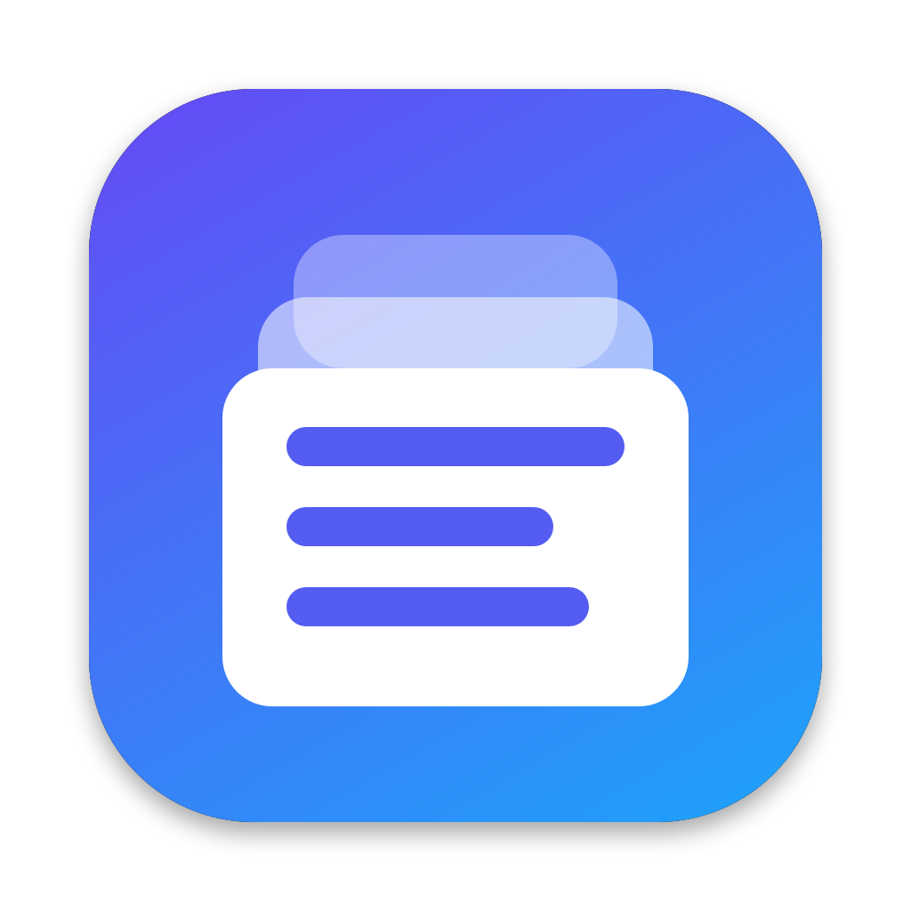
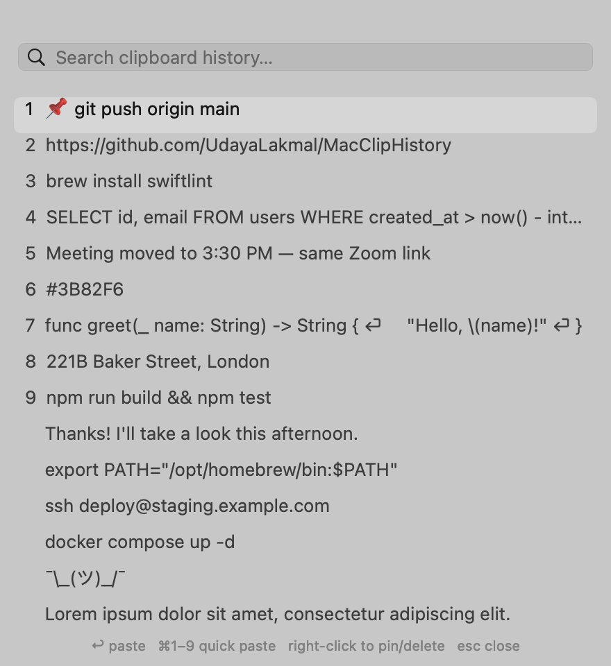
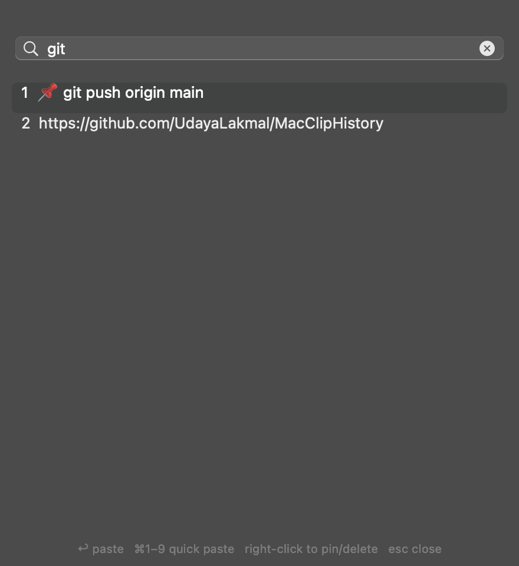

<p align="center">
  
</p>

<h1 align="center">ClipStack: Free Clipboard Manager for Mac</h1>

<p align="center">
  <b>Clipboard history for macOS</b>: like <b>Win + V</b> on Windows or the GNOME clipboard extensions on Linux.<br>
  Press <kbd>⌃</kbd><kbd>⌘</kbd><kbd>V</kbd> anywhere, type a few letters, hit <kbd>↩</kbd>, and it's pasted.<br>
  Free, open source, lightweight, private. Runs on Apple Silicon and Intel Macs.
</p>

<p align="center">
  <a href="https://github.com/UdayaLakmal/ClipStack/releases/latest"></a>
  
  
  <a href="LICENSE"></a>
  <a href="https://github.com/UdayaLakmal/ClipStack/actions/workflows/build.yml"></a>
</p>

<p align="center">
  
  &nbsp;
  
</p>

ClipStack is a free, open-source **clipboard manager for Mac** that remembers everything you copy, so you can find it and paste it again later. It lives in the menu bar, opens with one shortcut, and pastes straight into the app you're using. If you've been looking for **Windows Win+V clipboard history on a Mac**, a simple **copy-paste history tool for macOS**, or a lightweight alternative to bigger clipboard apps, this is it.

**Contents:** [Features](#features) · [Requirements](#requirements-and-supported-devices) · [Install](#install-step-by-step) · [Usage](#usage) · [Privacy](#privacy) · [FAQ](#faq) · [Troubleshooting](#troubleshooting) · [Build from source](#build-from-source)

---

## Features

- **Global shortcut**: <kbd>⌃</kbd><kbd>⌘</kbd><kbd>V</kbd> opens your clipboard history next to the mouse pointer, from any app.
- **Instant search**: start typing to filter. <kbd>↑</kbd> <kbd>↓</kbd> to move, <kbd>↩</kbd> or double-click to paste, <kbd>Esc</kbd> to close.
- **Quick paste**: <kbd>⌘</kbd><kbd>1</kbd> … <kbd>⌘</kbd><kbd>9</kbd> pastes one of the top nine items straight away.
- **Pins**: right-click an item to pin it. Pinned items stay at the top and survive *Clear History*.
- **Pastes for you**: picks the item, puts it on the clipboard and presses <kbd>⌘</kbd><kbd>V</kbd> in the app you were using.
- **Respects password managers**: anything marked as concealed or transient (1Password, Bitwarden, KeePassXC and others) is never recorded.
- **Remembers 300 items** across restarts. Duplicates move to the top instead of piling up.
- **Launch at Login** so it's always ready.
- **Lightweight**: about 1 MB, no dependencies, no network access, no Dock icon.
- **Universal**: native on Apple Silicon (M1, M2, M3, M4) and Intel Macs.

<p align="center">
  
  <br><sub>Type to filter: here, everything containing “git”.</sub>
</p>

## Requirements and supported devices

| | Supported |
|---|---|
| **macOS** | 13 Ventura or later, including 14 Sonoma, 15 Sequoia and 26 Tahoe |
| **Processor** | Apple Silicon (M1, M2, M3, M4 and later) and Intel. One universal download runs natively on both. |
| **Macs** | Any Mac that runs macOS 13+: MacBook Air, MacBook Pro, iMac, Mac mini, Mac Studio, Mac Pro |
| **Disk / memory** | About 1 MB on disk, very little memory |
| **Keyboard** | Any. The shortcut uses the key in the **V** position on a US layout. |
| **Not supported** | macOS 12 Monterey or older, iPhone, iPad |

Tested on macOS 14 Sonoma with Apple Silicon. Reports from other versions are welcome in [Issues](https://github.com/UdayaLakmal/ClipStack/issues).

## Install (step by step)

### 1. Download

Download **`ClipStack-x.y.z.zip`** from the [latest release](https://github.com/UdayaLakmal/ClipStack/releases/latest).

### 2. Move it to Applications

Double-click the zip to unzip it, then drag **ClipStack.app** into your **Applications** folder.

### 3. Open it the first time

ClipStack isn't notarized by Apple (that needs a paid developer account), so macOS blocks the first launch with a warning like *“Apple could not verify ClipStack is free of malware”*. This is expected. Use **one** of these:

- **Right-click** (or Control-click) ClipStack.app → **Open** → **Open**.
- Or try to open it once, then go to **System Settings → Privacy & Security**, scroll down and click **Open Anyway**.
- Or run this once in Terminal:
  ```bash
  xattr -dr com.apple.quarantine /Applications/ClipStack.app
  ```

A clipboard icon 📋 appears in the **menu bar** at the top of the screen. There's no window and no Dock icon; that's normal.

### 4. Allow auto-paste (Accessibility permission)

To press <kbd>⌘</kbd><kbd>V</kbd> for you, macOS requires Accessibility permission. ClipStack asks on first launch.

1. Open **System Settings → Privacy & Security → Accessibility**.
2. Switch on **ClipStack**. If it isn't listed, click **+**, choose **ClipStack** from Applications, and switch it on.
3. Click the menu bar icon and check it says **Auto-paste: On**. If it still says *Off*, quit ClipStack and open it again.

Without this permission ClipStack still works: choosing an item copies it, and you press <kbd>⌘</kbd><kbd>V</kbd> yourself.

### 5. Start it automatically

Click the menu bar icon → **Launch at Login** so it shows a checkmark ✓. ClipStack now starts every time you log in.

### 6. Try it

Copy a few things, then press <kbd>⌃</kbd><kbd>⌘</kbd><kbd>V</kbd> in any text field. Pick an item and press <kbd>↩</kbd>.

### Updating to a new version

1. Quit ClipStack (menu bar icon → **Quit ClipStack**).
2. Replace the app in Applications with the new one, and do step 3 again if macOS warns you.
3. **Re-grant Accessibility:** in **System Settings → Privacy & Security → Accessibility**, select ClipStack, click **–** to remove it, then add it again with **+**. macOS treats each new version as a different app, so the old entry no longer works even if it looks switched on.

Your history and pins are kept.

### Uninstall

1. Menu bar icon → untick **Launch at Login**, then **Quit ClipStack**.
2. Delete **ClipStack.app** from Applications.
3. Optional: delete your history folder `~/Library/Application Support/ClipStack`, and remove ClipStack from the Accessibility list.

## Usage

| Action | How |
|---|---|
| Open clipboard history | <kbd>⌃</kbd><kbd>⌘</kbd><kbd>V</kbd>, or menu bar icon → **Show History** |
| Search | Just start typing |
| Move selection | <kbd>↑</kbd> / <kbd>↓</kbd> |
| Paste selected item | <kbd>↩</kbd> or double-click |
| Paste item 1–9 | <kbd>⌘</kbd><kbd>1</kbd> … <kbd>⌘</kbd><kbd>9</kbd> |
| Pin / unpin, delete | Right-click an item |
| Close | <kbd>Esc</kbd> or click elsewhere |
| Clear history (keeps pins) | Menu bar icon → **Clear History** |
| Start automatically | Menu bar icon → **Launch at Login** |
| Open the menu when the icon is hidden | Open ClipStack again from Launchpad or Spotlight. The menu appears at your mouse pointer. |

## Privacy

- Your history stays on your Mac, in `~/Library/Application Support/ClipStack/history.json`.
- ClipStack makes **no network connections** and collects no data. No accounts, no analytics.
- Items that password managers flag as secret (`org.nspasteboard.ConcealedType`, `TransientType`, `AutoGeneratedType`) are skipped.
- Diagnostic logs record events like “paste: trusted=true”, never what you copied.
- To wipe everything, quit ClipStack and delete that folder.

## FAQ

**How do I see my clipboard history on a Mac?**
macOS only remembers the last thing you copied. Install ClipStack and press <kbd>⌃</kbd><kbd>⌘</kbd><kbd>V</kbd> to see everything you've copied since.

**Is there a Win+V (Windows clipboard history) for Mac?**
Not built in. ClipStack gives you the same thing: one shortcut, a searchable list, and paste.

**Is ClipStack free?**
Yes. It's free and open source under the MIT License.

**Does it save passwords?**
No, as long as your password manager marks them as secret, which 1Password, Bitwarden, KeePassXC and most others do.

**Does it sync between Macs or with iPhone?**
No. Everything stays on the Mac you copied it on.

**Does it save images and files?**
Not yet; text only. It's on the [roadmap](#roadmap).

**Why does it need Accessibility permission?**
Only to press <kbd>⌘</kbd><kbd>V</kbd> for you. It's optional: without it, ClipStack copies the item and you paste it yourself.

## Troubleshooting

**I can't see the menu bar icon.**
On MacBooks with a notch, macOS hides extra menu bar icons behind it when space runs out. Open ClipStack again from Launchpad or Spotlight, and its menu appears at your mouse pointer. Quitting a few other menu bar apps also frees up space.

**Picking an item copies it but doesn't paste.**
Accessibility permission is missing or belongs to an older version. The menu bar icon will show **Auto-paste: Off — Fix…**. Remove ClipStack from **Accessibility** with **–**, add it again with **+**, then quit and reopen ClipStack.

**Nothing happens when I press ⌃⌘V.**
Another app may already use that shortcut. Check that ClipStack is running (menu bar icon), or change the shortcut in `Sources/main.swift` and rebuild.

**“ClipStack can't be opened because Apple cannot check it for malicious software.”**
See [step 3](#3-open-it-the-first-time).

**Seeing what happens behind the scenes.**
Run this in Terminal, then use ClipStack:
```bash
log stream --predicate 'subsystem == "io.github.udayalakmal.clipstack"'
```

## Build from source

You need the Xcode Command Line Tools (`xcode-select --install`). Xcode itself is not required.

```bash
git clone https://github.com/UdayaLakmal/ClipStack.git
cd ClipStack
scripts/build.sh install
```

That builds a universal `ClipStack.app`, copies it to `~/Applications` and launches it.

| Command | Result |
|---|---|
| `scripts/build.sh` | Builds `build/ClipStack.app` (universal) |
| `scripts/build.sh install` | Builds, installs to `~/Applications`, launches |
| `scripts/build.sh release` | Builds and zips to `dist/ClipStack-<version>.zip` with a SHA-256 checksum |
| `scripts/build.sh screenshots` | Regenerates the images in `docs/images` from sample data |
| `scripts/build.sh icon` | Regenerates `Resources/AppIcon.icns` from `scripts/make-icon.swift` |

Builds are signed ad-hoc, so macOS asks for Accessibility permission again after every rebuild. To avoid that, create a code-signing certificate (Keychain Access → Certificate Assistant → Create a Certificate, type **Code Signing**) and build with `CODESIGN_IDENTITY="Your Certificate Name" scripts/build.sh install`.

### Customising

Everything lives in [`Sources/main.swift`](Sources/main.swift):

| Want to change | Where |
|---|---|
| Shortcut | `HotKey(keyCode: kVK_ANSI_V, modifiers: controlKey \| cmdKey)` in `AppDelegate` |
| Number of items kept | `static let maxItems = 300` in `HistoryStore` |
| Popup size | `width: 440, height: 480` in `PickerController` |
| Ignored clipboard types | `ignoredTypes` in `ClipboardMonitor` |

### How it works

```
 ┌──────────────────┐  every 0.4 s   ┌──────────────┐  save   ┌───────────────────┐
 │ ClipboardMonitor │ ─────────────▶ │ HistoryStore │ ──────▶ │ history.json      │
 └──────────────────┘ new text only  └──────────────┘         └───────────────────┘
                                            │
  ⌃⌘V ──▶ HotKey (Carbon) ──▶ PickerController (floating panel, search + list)
                                            │ ↩ / double-click
                                            ▼
          copy to NSPasteboard ──▶ refocus previous app ──▶ simulated ⌘V
```

- **Clipboard watching**: macOS has no "clipboard changed" notification, so ClipStack checks `NSPasteboard.changeCount` a few times a second, which is cheap.
- **Shortcut**: registered with Carbon's `RegisterEventHotKey`, which works system-wide and needs no permission.
- **Picker**: a non-activating `NSPanel`, so the app you were typing in stays in front.
- **Paste**: a synthetic <kbd>⌘</kbd><kbd>V</kbd> via `CGEvent`, which is why Accessibility access is needed.

### Releasing a new version

1. Update [`VERSION`](VERSION) and add an entry to [`CHANGELOG.md`](CHANGELOG.md).
2. `scripts/build.sh release`
3. Commit, tag and publish:
   ```bash
   git commit -am "Release vX.Y.Z" && git tag -a vX.Y.Z -m "ClipStack X.Y.Z" && git push --follow-tags
   gh release create vX.Y.Z dist/ClipStack-X.Y.Z.zip dist/ClipStack-X.Y.Z.zip.sha256 --notes-file <notes>
   ```

## Roadmap

- [ ] Images and files in history
- [ ] Settings window for shortcut and history size
- [ ] Per-app ignore list
- [ ] Paste as plain text modifier
- [ ] Signed and notarized builds, Homebrew cask

Ideas and pull requests are welcome. Please [open an issue](https://github.com/UdayaLakmal/ClipStack/issues).

## License

[MIT](LICENSE) © 2026 Lakmal Rathnasiri
