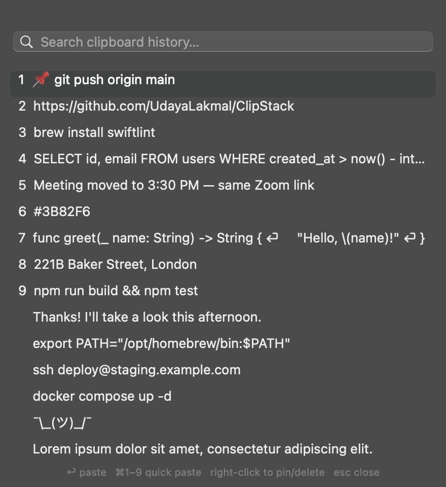

<p align="center">
  
</p>

<h1 align="center">ClipStack</h1>

<p align="center">
  A tiny, fast clipboard history manager for macOS, like <b>Win + V</b> on Windows or the GNOME clipboard extensions on Linux.<br>
  Press <kbd>⌃</kbd><kbd>⌘</kbd><kbd>V</kbd> anywhere, type a few letters, hit <kbd>↩</kbd>, and it's pasted.
</p>

<p align="center">
  <a href="https://github.com/UdayaLakmal/ClipStack/releases/latest"></a>
  
  
  <a href="LICENSE"></a>
  <a href="https://github.com/UdayaLakmal/ClipStack/actions/workflows/build.yml"></a>
</p>

<p align="center">
  
  &nbsp;
  
</p>

---

## Features

- **Global shortcut**: <kbd>⌃</kbd><kbd>⌘</kbd><kbd>V</kbd> opens your history right next to the mouse pointer, from any app.
- **Instant search**: start typing to filter. <kbd>↑</kbd> <kbd>↓</kbd> to move, <kbd>↩</kbd> to paste, <kbd>Esc</kbd> to close.
- **Quick paste**: <kbd>⌘</kbd><kbd>1</kbd> … <kbd>⌘</kbd><kbd>9</kbd> pastes one of the top nine items straight away.
- **Pins**: right-click an item to pin it. Pinned items stay at the top and survive *Clear History*.
- **Pastes for you**: picks the item, puts it on the clipboard and presses <kbd>⌘</kbd><kbd>V</kbd> in the app you were using.
- **Respects password managers**: anything marked as concealed or transient (1Password, Bitwarden, KeePassXC and others) is never recorded.
- **Remembers 300 items** across restarts. Duplicates move to the top instead of piling up.
- **Launch at Login** toggle in the menu bar.
- **Lightweight**: one Swift file, no dependencies, no network access, no Dock icon. It lives in the menu bar.
- **Universal**: runs natively on Apple Silicon and Intel Macs.

<p align="center">
  
  <br><sub>Type to filter: here, everything containing “git”.</sub>
</p>

## Install

### Download (recommended)

1. Download **`ClipStack-x.y.z.zip`** from the [latest release](https://github.com/UdayaLakmal/ClipStack/releases/latest).
2. Unzip it and drag **ClipStack.app** into **Applications**.
3. Open it. Because the app isn't notarized by Apple, the first launch is blocked. Either:
   - **Right-click** ClipStack.app → **Open** → **Open**, or
   - open **System Settings → Privacy & Security** and click **Open Anyway**, or
   - run this once in Terminal:
     ```bash
     xattr -dr com.apple.quarantine /Applications/ClipStack.app
     ```
4. A clipboard icon appears in the menu bar. You're done.

### Build from source

You need the Xcode Command Line Tools (`xcode-select --install`). Xcode itself is not required.

```bash
git clone https://github.com/UdayaLakmal/ClipStack.git
cd ClipStack
scripts/build.sh install
```

That builds a universal `ClipStack.app`, copies it to `~/Applications` and launches it.

## First-run setup: allow pasting

To press <kbd>⌘</kbd><kbd>V</kbd> for you, macOS requires **Accessibility** permission. ClipStack asks on first launch.

1. Open **System Settings → Privacy & Security → Accessibility**.
2. Turn on **ClipStack**.

Without it, ClipStack still works: choosing an item copies it, and you press <kbd>⌘</kbd><kbd>V</kbd> yourself. You can open the prompt again from the menu bar: **Grant Paste Permission…**

> **Updating?** After replacing the app with a new version, macOS may silently stop trusting it. Remove ClipStack from the Accessibility list with the **–** button, then turn it on again.

## Usage

| Action | How |
|---|---|
| Open history | <kbd>⌃</kbd><kbd>⌘</kbd><kbd>V</kbd>, or menu bar icon → **Show History** |
| Search | Just start typing |
| Move selection | <kbd>↑</kbd> / <kbd>↓</kbd> |
| Paste selected | <kbd>↩</kbd> or double-click |
| Paste item 1–9 | <kbd>⌘</kbd><kbd>1</kbd> … <kbd>⌘</kbd><kbd>9</kbd> |
| Pin / unpin, delete | Right-click an item |
| Close | <kbd>Esc</kbd> or click elsewhere |
| Clear history (keeps pins) | Menu bar icon → **Clear History** |
| Start automatically | Menu bar icon → **Launch at Login** |

## Privacy

- Your history stays on your Mac, in `~/Library/Application Support/ClipStack/history.json`.
- ClipStack makes **no network connections** and collects no data.
- Items that password managers flag as secret (`org.nspasteboard.ConcealedType`, `TransientType`, `AutoGeneratedType`) are skipped.
- To wipe everything, quit ClipStack and delete that folder.

## Customising

Everything lives in [`Sources/main.swift`](Sources/main.swift). Common tweaks:

| Want to change | Where |
|---|---|
| Shortcut | `HotKey(keyCode: kVK_ANSI_V, modifiers: controlKey \| cmdKey)` in `AppDelegate` |
| Number of items kept | `static let maxItems = 300` in `HistoryStore` |
| Popup size | `width: 440, height: 480` in `PickerController` |
| Ignored clipboard types | `ignoredTypes` in `ClipboardMonitor` |

Then rebuild with `scripts/build.sh install`.

## How it works

```
 ┌──────────────────┐  every 0.4 s   ┌──────────────┐  save   ┌───────────────────┐
 │ ClipboardMonitor │ ─────────────▶ │ HistoryStore │ ──────▶ │ history.json      │
 └──────────────────┘ new text only  └──────────────┘         └───────────────────┘
                                            │
  ⌃⌘V ──▶ HotKey (Carbon) ──▶ PickerController (floating panel, search + list)
                                            │ ↩
                                            ▼
                       copy to NSPasteboard ──▶ simulated ⌘V into the frontmost app
```

- **Clipboard watching**: macOS has no "clipboard changed" notification, so ClipStack checks `NSPasteboard.changeCount` a few times a second, which is cheap.
- **Shortcut**: registered with Carbon's `RegisterEventHotKey`, which works system-wide and needs no permission.
- **Picker**: a non-activating `NSPanel`, so the app you were typing in stays in front and receives the paste.
- **Paste**: a synthetic <kbd>⌘</kbd><kbd>V</kbd> via `CGEvent`, which is why Accessibility access is needed.

## Build commands

| Command | Result |
|---|---|
| `scripts/build.sh` | Builds `build/ClipStack.app` (universal) |
| `scripts/build.sh install` | Builds, installs to `~/Applications`, launches |
| `scripts/build.sh release` | Builds and zips to `dist/ClipStack-<version>.zip` with a SHA-256 checksum |
| `scripts/build.sh screenshots` | Regenerates the images in `docs/images` from sample data |
| `scripts/build.sh icon` | Regenerates `Resources/AppIcon.icns` from `scripts/make-icon.swift` |

The version number lives in [`VERSION`](VERSION).

## Releasing a new version

1. Update [`VERSION`](VERSION) and add an entry to [`CHANGELOG.md`](CHANGELOG.md).
2. `scripts/build.sh release`
3. Commit, tag and publish:
   ```bash
   git commit -am "Release vX.Y.Z" && git tag vX.Y.Z && git push --follow-tags
   gh release create vX.Y.Z dist/ClipStack-X.Y.Z.zip dist/ClipStack-X.Y.Z.zip.sha256 --notes-file <notes>
   ```

## Roadmap

- [ ] Images and files in history
- [ ] Settings window for shortcut and history size
- [ ] Per-app ignore list
- [ ] Paste as plain text modifier
- [ ] Signed and notarized builds, Homebrew cask

Ideas and pull requests are welcome. Please [open an issue](https://github.com/UdayaLakmal/ClipStack/issues).

## Troubleshooting

**Nothing happens when I press ⌃⌘V.** Another app may already use that shortcut. Change it in `Sources/main.swift` and rebuild.

**The item is copied but not pasted.** Accessibility permission is missing or stale. See [First-run setup](#first-run-setup-allow-pasting).

**"ClipStack can't be opened because Apple cannot check it for malicious software."** See step 3 of [Install](#download-recommended).

## License

[MIT](LICENSE) © 2026 Lakmal Rathnasiri
